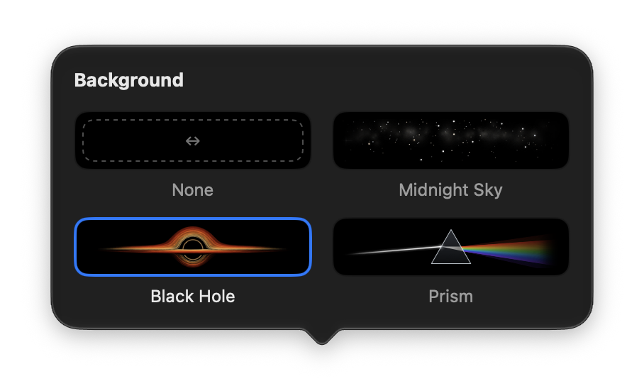

<p align="center">
  
</p>

<h1 align="center">GlintBar</h1>

<p align="center">
  A Liquid Glass Touch Bar for macOS 26 and later.
</p>

---

<p align="center">
    <a href="#features">Features</a> · 
    <a href="#requirements">Requirements</a> · 
    <a href="#installation">Installation</a> · 
    <a href="#license">License</a>
</p>

---

macOS's own Touch Bar has been left behind: volume and brightness popovers hang instead of
closing, and none of it got the Liquid Glass look. GlintBar replaces the Control Strip in every
app with a glassy bar of its own that you can arrange however you like.


## Features

### A better Control Strip

Out of the box, GlintBar gives you the controls you reach for most:

- **Media**: previous, play/pause and next. Play/pause always shows whether something is
  actually playing.
- **Levels**: keyboard backlight, display brightness and volume.
- **Shortcuts**: screenshot and Siri.
- **App controls**: tap the app icon on the left to hand the Touch Bar back to the current app.
  GlintBar's button in Apple's Control Strip brings it back, with a little glint so it's easy
  to spot.

### Sliders that feel right

Touch the brightness, backlight or volume button and a slider grows straight out of it. Keep
your finger down and drag: the level follows from where it is, so it never jumps. Let go and
the slider closes on its own after a moment.


### Now Playing

See the current track at a glance, with a progress line underneath. Tap to play or pause, or
press and slide to scrub through the song with elapsed and remaining time.


### Make it yours

Choose **Customize GlintBar** from the menu bar (or just open GlintBar.app again) and drag items into, along and out of the bar.
The Touch Bar updates live as you go.


|             | Available items                                                                                              |
| ----------- | ------------------------------------------------------------------------------------------------------------ |
| **Media**   | Previous, Play/Pause, Next, Now Playing                                                                      |
| **Levels**  | Volume, Brightness and Keyboard Backlight sliders, step buttons for each (hold to repeat), Mute, Night Shift |
| **Info**    | Clock, Battery, System Resources (CPU, GPU, memory and storage)                                              |
| **System**  | Spotlight, Siri, Mission Control, Apps, Show Desktop, Input Sources, Quick Actions, Screenshot               |
| **Session** | Screen Saver, Lock Screen, Sleep                                                                             |
| **Apps**    | Buttons that launch any app you pick. Drop apps from Finder onto the bar, or right-click one to change it    |
| **Layout**  | Spaces and flexible spaces, which can show a background                                                      |

For example, a bar with Now Playing, a flexible space with the Prism background, a few favorite apps, System Resources, Battery and Clock:


### Backgrounds

Flexible spaces don't have to stay empty. Click one in the Customize window to fill it with a picture:

<p align="center">
  
</p>

### Menu bar

GlintBar's menu bar item lets you switch between GlintBar and app controls, open the
customization window, choose how quickly sliders close, and turn on launch at login.

## Requirements

- A MacBook Pro with a Touch Bar
- macOS 26 or later
- Xcode 26 or later, only if you build it yourself

## Installation

### Download

1. Download `GlintBar.dmg` from the
   [latest release](https://github.com/ace-of-aces/GlintBar/releases/latest) and open it.
2. Drag `GlintBar.app` onto the Applications folder, then eject the disk image.
3. Clear the quarantine flag macOS puts on downloaded apps (see below for why):

   ```bash
   xattr -dr com.apple.quarantine /Applications/GlintBar.app
   ```

4. Open GlintBar.

To start GlintBar automatically, choose **Launch at Login** from its menu bar item. To update,
quit GlintBar, drag the newer version over the old one and repeat steps 3 and 4.

#### Why macOS blocks GlintBar

GlintBar isn't signed with an Apple Developer ID or notarized by Apple (it uses private APIs,
so Apple wouldn't notarize it anyway). It's only ad-hoc signed. Gatekeeper refuses to open
apps like that when they come from the internet and says GlintBar "can't be opened" or "is
damaged", but that only refers to the missing signature.

Removing the quarantine flag with the command above tells macOS that you trust this copy. It
also covers the helper library GlintBar loads for Now Playing, which macOS would otherwise
block separately.

If you'd rather not use Terminal, open GlintBar once, dismiss the warning, then go to
**System Settings → Privacy & Security**, scroll down and click **Open Anyway** next to the
message about GlintBar. If Now Playing doesn't show anything afterwards, use the `xattr`
command instead.

If you'd rather not trust a prebuilt binary at all, build GlintBar yourself.

### Build from source

You'll need Xcode 26 or later. Clone the repository, then run:

```bash
./scripts/build-app.sh --install
```

This builds `GlintBar.app`, copies it to `~/Applications` and launches it. Run the same
command again to update. To only build the app (into `build/GlintBar.app`) without
installing it, leave off `--install`. Apps you build yourself aren't quarantined, so
Gatekeeper doesn't get in the way.

## Good to know

GlintBar relies on private macOS APIs to control the Touch Bar, brightness and media. That
means it can't be distributed through the Mac App Store, and a macOS update may break some or
all of it.

## For developers

How GlintBar works, how the project is laid out and how to debug it is covered in the
[technical documentation](docs/README.md).

## License

GlintBar is available under the [MIT License](LICENSE).
