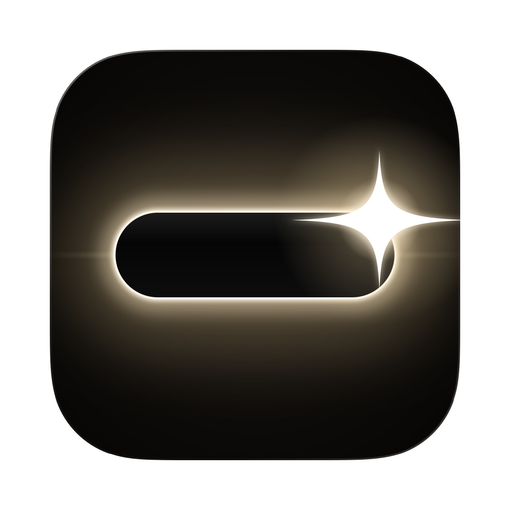
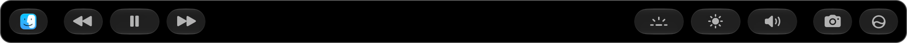
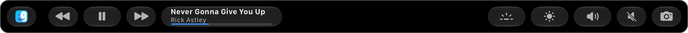
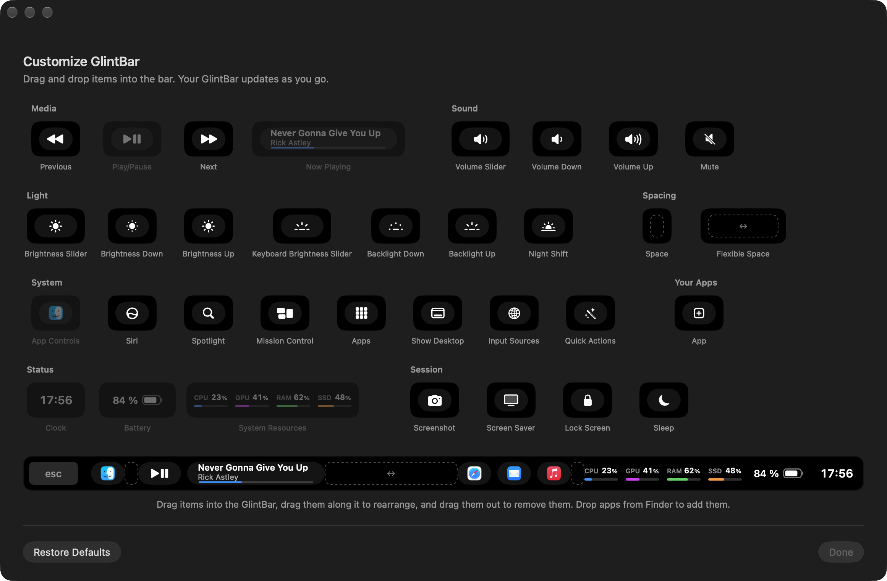
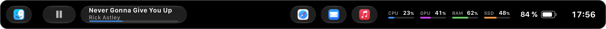

<p align="center">
  
</p>

<h1 align="center">GlintBar</h1>

<p align="center">
  A Liquid Glass Touch Bar for macOS 26 and later.
</p>

---

<p align="center">
    <a href="#features">Features</a> · 
    <a href="#requirements">Requirements</a> · 
    <a href="#installation">Installation</a>
</p>

---

macOS's own Touch Bar has been left behind: volume and brightness popovers hang instead of
closing, and none of it got the Liquid Glass look. GlintBar replaces the Control Strip in every
app with a glassy bar of its own that you can arrange however you like.



## Features

### A better Control Strip

Out of the box, GlintBar gives you the controls you reach for most:

- **Media**: previous, play/pause and next. Play/pause always shows whether something is
  actually playing.
- **Levels**: keyboard backlight, display brightness and volume.
- **Shortcuts**: screenshot and Siri.
- **App controls**: tap the app icon on the left to hand the Touch Bar back to the current app.
  GlintBar's button in Apple's Control Strip brings it back, with a little glint so it's easy
  to spot.

### Sliders that feel right

Touch the brightness, backlight or volume button and a slider grows straight out of it. Keep
your finger down and drag: the level follows from where it is, so it never jumps. Let go and
the slider closes on its own after a moment.


### Now Playing

See the current track at a glance, with a progress line underneath. Tap to play or pause, or
press and slide to scrub through the song with elapsed and remaining time.




### Make it yours

Choose **Customize GlintBar** from the menu bar (or just open GlintBar.app again) and drag items into, along and out of the bar.
The Touch Bar updates live as you go.



|             | Available items                                                                                              |
| ----------- | ------------------------------------------------------------------------------------------------------------ |
| **Media**   | Previous, Play/Pause, Next, Now Playing                                                                      |
| **Levels**  | Volume, Brightness and Keyboard Backlight sliders, step buttons for each (hold to repeat), Mute, Night Shift |
| **Info**    | Clock, Battery, System Resources (CPU, GPU, memory and storage)                                              |
| **System**  | Spotlight, Siri, Mission Control, Apps, Show Desktop, Input Sources, Quick Actions, Screenshot               |
| **Session** | Screen Saver, Lock Screen, Sleep                                                                             |
| **Apps**    | Buttons that launch any app you pick. Drop apps from Finder onto the bar, or right-click one to change it    |
| **Layout**  | Spaces and flexible spaces                                                                                   |

For example, a bar with Now Playing, a few favorite apps, System Resources, Battery and Clock:



### Menu bar

GlintBar's menu bar item lets you switch between GlintBar and app controls, open the
customization window, choose how quickly sliders close, and turn on launch at login.

## Requirements

- A MacBook Pro with a Touch Bar
- macOS 26 or later
- Xcode 26 or later, to build it

## Installation

Currently, GlintBar must be built from source. Clone the repository, then run:

```bash
./scripts/build-app.sh --install
```

This builds `GlintBar.app`, copies it to `~/Applications` and launches it. Run the same
command again to update. To only build the app (into `build/GlintBar.app`) without
installing it, leave off `--install`.

To start GlintBar automatically, choose **Launch at Login** from its menu bar item.

## Good to know

GlintBar relies on private macOS APIs to control the Touch Bar, brightness and media. That
means it can't be distributed through the Mac App Store, and a macOS update may break some or
all of it.

## For developers

How GlintBar works, how the project is laid out and how to debug it is covered in the
[technical documentation](docs/README.md).
